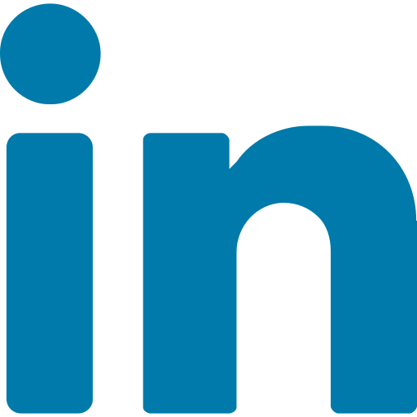

# Hi there, I'm Saransh - aka CryptoSingh 👋

<div align="center">

</div>

## I'm a Student and a Gamer!

- 🔭 I’m currently working on my problem solving skills and building hobby projects.
- 🌱 I’m currently learning Go and Machine Learning.
- ⚡ Fun fact: I love to watch sci-fi movies and playing FPS/RPG games.

<a href="https://www.saransh.pro/" target="_blank"></a>&nbsp;&nbsp;
<a href="https://discord.gg/6efHuzv" target="_blank"></a>&nbsp;&nbsp;
<a href="https://cryptosingh1337.medium.com/" target="_blank"></a>&nbsp;&nbsp;
<a href="https://youtube.com/cryptosingh" target="_blank"></a>&nbsp;&nbsp;
<a href="https://linkedin.com/in/saransh-kumar-2k19/" target="_blank"></a>&nbsp;&nbsp;
<a href="https://leetcode.com/cryptosingh/" target="_blank"></a>&nbsp;&nbsp;
<a href="https://codechef.com/users/cryptosingh" target="_blank"></a>
<br>
<br>
<a href="https://github.com/CryptoSingh1337/CryptoSingh1337/raw/master/resume/SaranshKumar-Resume.pdf" download></a>

##

### Technologies and Tools:

<div align="center">
 <code></code>
 <code></code>
 <code></code>
 <code></code>
 <code></code>
 <code></code>
 <code></code>
 <code></code>
 <code></code>
 <code></code>
 <code></code>
 <code></code>
</div>

<br>

[](https://wakatime.com/@b9df6102-292d-4e04-8c49-0347a58ded19)
<!--START_SECTION:waka-->


**🐱 My GitHub Data** 

> 📦 260.7 kB Used in GitHub's Storage 
 > 
> 🏆 2,177 Contributions in the Year 2026
 > 
> 💼 Opted to Hire
 > 
> 📜 60 Public Repositories 
 > 
> 🔑 27 Private Repositories 
 > 
**I'm a Night 🦉** 

```text
🌞 Morning                1141 commits        █░░░░░░░░░░░░░░░░░░░░░░░░   02.24 % 
🌆 Daytime                12904 commits       ██████░░░░░░░░░░░░░░░░░░░   25.32 % 
🌃 Evening                20567 commits       ██████████░░░░░░░░░░░░░░░   40.36 % 
🌙 Night                  16352 commits       ████████░░░░░░░░░░░░░░░░░   32.09 % 
```


📊 **This Week I Spent My Time On** 

```text
🕑︎ Time Zone: Asia/Kolkata

💬 Programming Languages: 
Markdown                 21 hrs 59 mins      █████████░░░░░░░░░░░░░░░░   37.14 % 
Java                     14 hrs 24 mins      ██████░░░░░░░░░░░░░░░░░░░   24.32 % 
Go                       10 hrs 9 mins       ████░░░░░░░░░░░░░░░░░░░░░   17.15 % 
JSON                     2 hrs 8 mins        █░░░░░░░░░░░░░░░░░░░░░░░░   03.62 % 
Vue                      1 hr 52 mins        █░░░░░░░░░░░░░░░░░░░░░░░░   03.17 % 

🔥 Editors: 
Claude Code              39 hrs 50 mins      █████████████████░░░░░░░░   67.29 % 
IntelliJ IDEA            19 hrs 14 mins      ████████░░░░░░░░░░░░░░░░░   32.49 % 
Sublime Text             8 mins              ░░░░░░░░░░░░░░░░░░░░░░░░░   00.23 % 

💻 Operating System: 
Windows                  32 hrs 50 mins      ██████████████░░░░░░░░░░░   55.46 % 
Mac                      26 hrs 22 mins      ███████████░░░░░░░░░░░░░░   44.54 % 
```

🤖 **AI Coding This Week** 

```text
⏱ AI Coding Time: 46 hrs (77.7%)

✍️ 70,945 lines written by AI, 2,386 lines written by hand (96.75% AI-written)

🔤 36,181,210 Input Tokens, 10,344,834 Output Tokens

💵 $908.27 Estimated AI Cost This Week

🧠 84 AI Sessions, 533 AI Prompts

Opus                     67,095 lines        ██████████████████████░░░   88.29 % 
Fable                    8,902 lines         ███░░░░░░░░░░░░░░░░░░░░░░   11.71 % 
Sonnet                   0 lines             ░░░░░░░░░░░░░░░░░░░░░░░░░   00.00 % 
Haiku                    0 lines             ░░░░░░░░░░░░░░░░░░░░░░░░░   00.00 % 

🔎 AI Coding Insights:
🤖 AI-Driven — 96.75% of written lines came from AI
📚 Verbose Prompter — average 3,895 characters per prompt
🔁 Iterative Prompter — average 6 prompts per session
🚀 High AI Trust — 3.73% of changed lines were hand-edited
```


 Last Updated on 17/11/2026 07:50:26 UTC
<!--END_SECTION:waka-->
