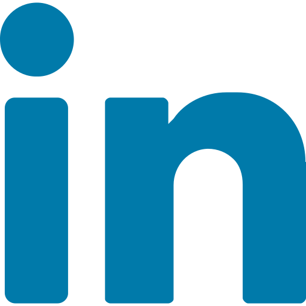

# Hi there, I'm Saransh - aka CryptoSingh 👋

<div align="center">

</div>

## I'm a Student and a Gamer!

- 🔭 I’m currently working on my problem solving skills and building hobby projects.
- 🌱 I’m currently learning Go and Machine Learning.
- ⚡ Fun fact: I love to watch sci-fi movies and playing FPS/RPG games.

<a href="https://www.saransh.pro/" target="_blank"></a>&nbsp;&nbsp;
<a href="https://discord.gg/6efHuzv" target="_blank"></a>&nbsp;&nbsp;
<a href="https://cryptosingh1337.medium.com/" target="_blank"></a>&nbsp;&nbsp;
<a href="https://youtube.com/cryptosingh" target="_blank"></a>&nbsp;&nbsp;
<a href="https://linkedin.com/in/saransh-kumar-2k19/" target="_blank"></a>&nbsp;&nbsp;
<a href="https://leetcode.com/cryptosingh/" target="_blank"></a>&nbsp;&nbsp;
<a href="https://codechef.com/users/cryptosingh" target="_blank"></a>
<br>
<br>
<a href="https://github.com/CryptoSingh1337/CryptoSingh1337/raw/master/resume/SaranshKumar-Resume.pdf" download></a>

##

### Technologies and Tools:

<div align="center">
 <code></code>
 <code></code>
 <code></code>
 <code></code>
 <code></code>
 <code></code>
 <code></code>
 <code></code>
 <code></code>
 <code></code>
 <code></code>
 <code></code>
</div>

<br>

[](https://wakatime.com/@b9df6102-292d-4e04-8c49-0347a58ded19)
<!--START_SECTION:waka-->


**🐱 My GitHub Data** 

> 📦 258.0 kB Used in GitHub's Storage 
 > 
> 🏆 2,057 Contributions in the Year 2026
 > 
> 💼 Opted to Hire
 > 
> 📜 60 Public Repositories 
 > 
> 🔑 26 Private Repositories 
 > 
**I'm a Night 🦉** 

```text
🌞 Morning                1141 commits        █░░░░░░░░░░░░░░░░░░░░░░░░   02.37 % 
🌆 Daytime                12374 commits       ██████░░░░░░░░░░░░░░░░░░░   25.66 % 
🌃 Evening                19422 commits       ██████████░░░░░░░░░░░░░░░   40.28 % 
🌙 Night                  15277 commits       ████████░░░░░░░░░░░░░░░░░   31.69 % 
```


📊 **This Week I Spent My Time On** 

```text
🕑︎ Time Zone: Asia/Kolkata

💬 Programming Languages: 
Markdown                 16 hrs 36 mins      ██████████░░░░░░░░░░░░░░░   39.61 % 
Go                       8 hrs 15 mins       █████░░░░░░░░░░░░░░░░░░░░   19.70 % 
Python                   5 hrs               ███░░░░░░░░░░░░░░░░░░░░░░   11.95 % 
Java                     3 hrs 21 mins       ██░░░░░░░░░░░░░░░░░░░░░░░   08.01 % 
Vue                      2 hrs 27 mins       █░░░░░░░░░░░░░░░░░░░░░░░░   05.88 % 

🔥 Editors: 
Claude Code              29 hrs 12 mins      █████████████████░░░░░░░░   69.65 % 
IntelliJ IDEA            12 hrs 39 mins      ████████░░░░░░░░░░░░░░░░░   30.17 % 
Sublime Text             4 mins              ░░░░░░░░░░░░░░░░░░░░░░░░░   00.18 % 

💻 Operating System: 
Windows                  37 hrs 35 mins      ██████████████████████░░░   89.66 % 
Mac                      4 hrs 20 mins       ███░░░░░░░░░░░░░░░░░░░░░░   10.34 % 
```

🤖 **AI Coding This Week** 

```text
⏱ AI Coding Time: 34 hrs 16 mins (81.72%)

✍️ 39,279 lines written by AI, 1,646 lines written by hand (95.98% AI-written)

🔤 31,108,658 Input Tokens, 8,156,618 Output Tokens

💵 $599.76 Estimated AI Cost This Week

🧠 71 AI Sessions, 620 AI Prompts

Opus                     42,990 lines        █████████████████████████   98.91 % 
Fable                    474 lines           ░░░░░░░░░░░░░░░░░░░░░░░░░   01.09 % 
Sonnet                   0 lines             ░░░░░░░░░░░░░░░░░░░░░░░░░   00.00 % 
Haiku                    0 lines             ░░░░░░░░░░░░░░░░░░░░░░░░░   00.00 % 

🔎 AI Coding Insights:
🤖 AI-Driven — 95.98% of written lines came from AI
📚 Verbose Prompter — average 4,409 characters per prompt
🔁 Iterative Prompter — average 9 prompts per session
🚀 High AI Trust — 3.98% of changed lines were hand-edited
```


 Last Updated on 12/11/2026 07:06:02 UTC
<!--END_SECTION:waka-->
